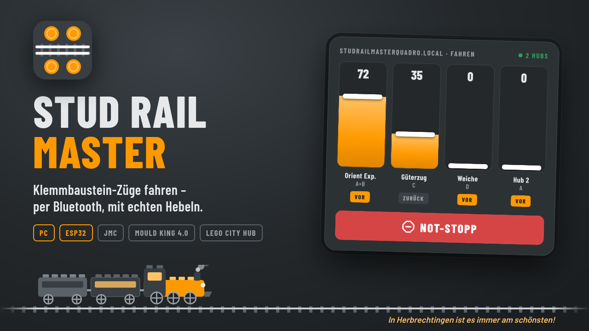
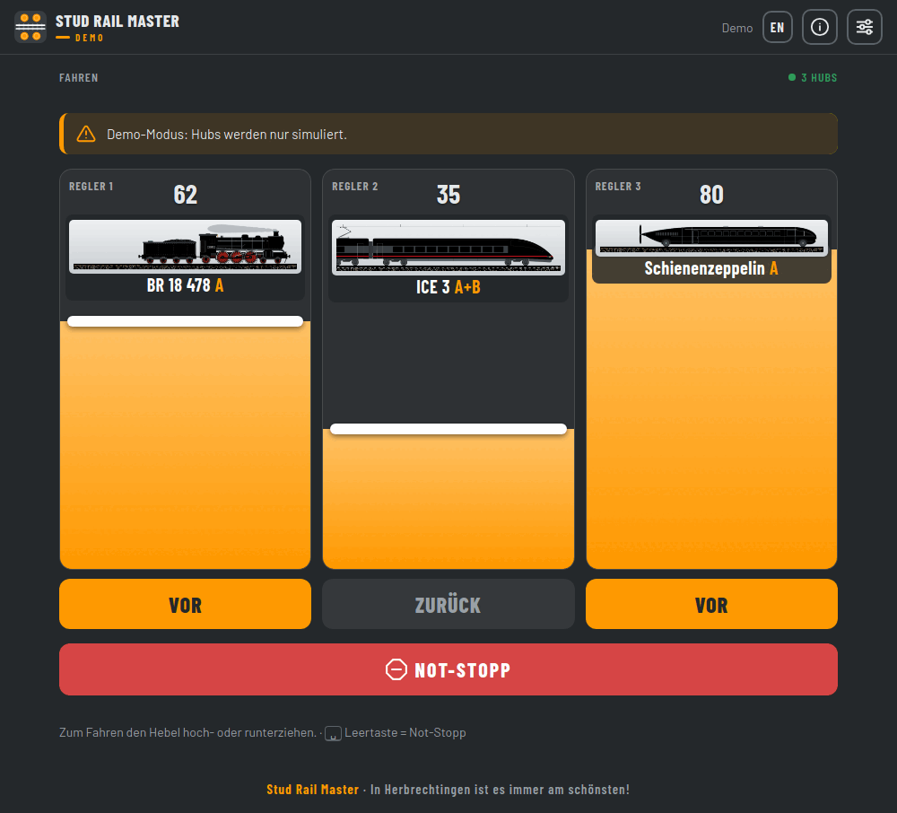
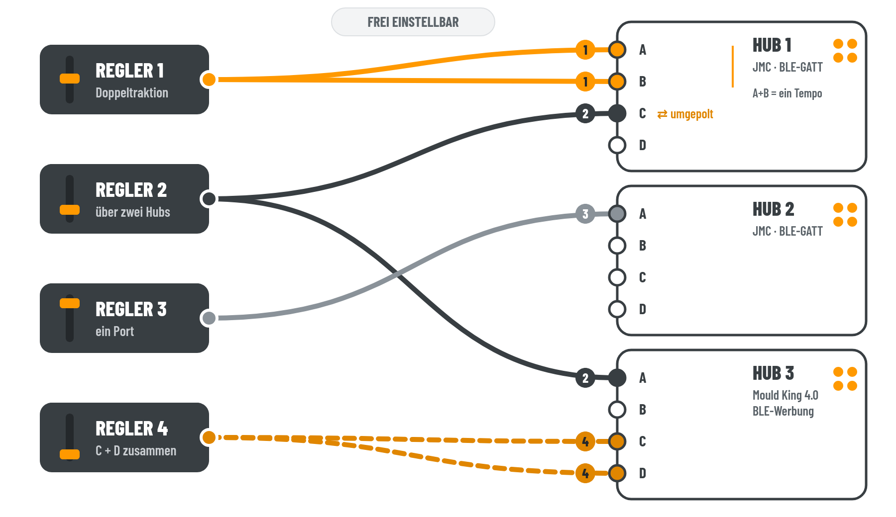
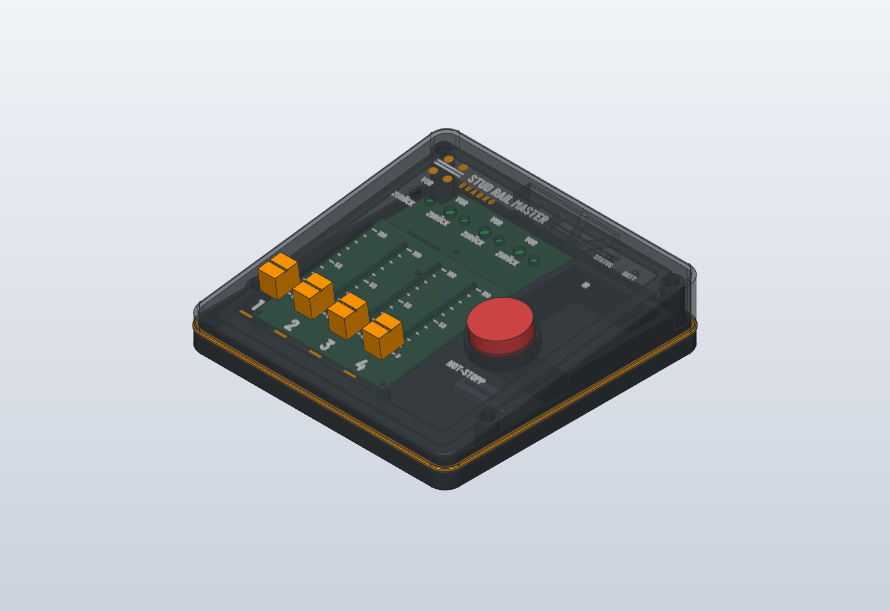

<b>Klemmbaustein-Züge vom Computer oder von einer selbst gebauten Fernbedienung aus fahren – per Bluetooth, ohne Internet, ohne Konto.</b>

🇬🇧 <a href="README.md">English version</a> · <a href="docs/de/installation.md">Installation</a> · <a href="docs/de/anleitung.md">Anleitung</a> · <a href="docs/de/fernbedienung-einrichten.md">Fernbedienung</a>

---

## Warum?

Auf der Anlage fahren Züge mit Motor-Hubs von drei Herstellern: ein günstiger JMC-Hub, ein Mould King 4.0 aus dem Orient Express und ein LEGO City Hub aus dem Güterzug 60337. Jeder Hub will seine eigene Handy-App. Jede App hat andere Schieberegler, zwei Züge gleichzeitig fahren heißt zwei Handys,.

Ich wollte **einen Fahrpult für alle Züge** – am besten mit **echten Hebeln**, die man mit dem Daumen schiebt, und einem **großen roten Knopf**, der wirklich alles anhält. Ohne Konto, ohne Werbung, ohne Cloud. Daraus sind zwei Dinge geworden:

| | |
|---|---|
| **Stud Rail Master** – das PC-Programm | für Windows, macOS und Linux. Hubs suchen, Fotos der Züge hinterlegen, Hebel zuordnen, losfahren. Läuft ohne zusätzliche Hardware. |
| **Stud Rail Master Quadro** – die Fernbedienung | ein ESP32 mit vier Schiebepotis, Richtungsschaltern und Not-Stopp. Fährt bis zu vier Hubs alleine, ganz ohne PC; eingestellt wird über eine Webseite im Handy-Browser. |

Beide sprechen dieselben Treiber und können sich abwechseln: Startet der PC, übernimmt er den Funk, wird er beendet, fährt wieder die Fernbedienung.

## So sieht es aus

Jede Buchse jedes Hubs bekommt einen Fahrregler – frei verteilt: zwei Motoren an einem Regler, ein Regler über mehrere Hubs (auch verschiedener Hersteller), einzelne Motoren umgepolt. Mehr dazu in der [Anleitung](docs/de/anleitung.md#das-prinzip-regler-und-hubs).

- **Ein Hebel pro Fahrregler** – hochziehen für mehr Tempo, ein Klick für die Richtung, ein großer roter Not-Stopp (auch per Leertaste).
- **Deine Züge, deine Bilder** – zu jedem Hub ein Foto, damit du immer weißt, welcher Hebel welchen Zug fährt.
- **Viele Züge gleichzeitig** – bis zu 16 Fahrregler; ein Regler kann mehrere Loks fahren, auch von verschiedenen Herstellern.
- **Sanfter Richtungswechsel** – der Zug bremst ab und fährt in die andere Richtung los, statt zu ruckeln.
- **Bleibt zu Hause** – kein Internet, kein Konto, keine Werbung, keine Datensammlung.
- **Hilfe eingebaut** – dieselbe Anleitung wie hier, offline im Programm (Knopf **?**).

## Welche Hubs?

| Hub | Windows | macOS | Linux | Fernbedienung |
|---|:-:|:-:|:-:|:-:|
| **JMC-Hub** (meldet sich als „JG_JMC-…“, Ports A–D) | ✔ | ✔ | ✔ | ✔ |
| **Mould King 4.0** (Ports A–D, bis zu 3 Hubs) | ⚠ noch nicht getestet | ✘ → Linux oder ESP32 mit Webseite | ✔ einmal freischalten | ✔ |
| **LEGO Powered Up City Hub** (88009, z. B. Set 60337, Ports A/B) | ✔ | ✔ | ✔ | ✔ |

Geplant: LEGO Technic Hub, Mould King 6.0.

## Los geht's

1. Das Programm für dein System von der **Releases**-Seite herunterladen und entpacken.
2. Starten, Hub einschalten, unter *Einstellungen → Hubs suchen* finden, einen Regler zuordnen – und losfahren.

Schritt für Schritt: **[Installation](docs/de/installation.md)** · **[Anleitung](docs/de/anleitung.md)** · **[Fernbedienung einrichten](docs/de/fernbedienung-einrichten.md)** · **[Zusammen mit der Fernbedienung](docs/de/esp-abgleich.md)**

Erst mal ohne Hub ausprobieren? Der **Demo-Modus** simuliert drei Züge (siehe Anleitung).

<b>Oder direkt aus dem Quellcode</b>

Mit Python 3.10 oder neuer: dieses Repository herunterladen oder klonen, dann `app/start.sh` (Linux), `app/start.command` (macOS) bzw. `app/start.bat` (Windows) starten. Der erste Start richtet alles ein und lädt einmalig die nötigen Python-Pakete herunter; danach startet es sofort.

## Sicherheit

Manche Hubs fahren mit dem letzten Befehl einfach weiter, wenn sie nichts mehr hören. Darum gilt überall:

- **Not-Stopp** hält alle Züge sofort an – auch mitten in einem Richtungswechsel.
- **Losfahren erst, wenn jeder Hebel einmal auf 0 stand** – nach dem Einschalten und nach jedem Not-Stopp.
- **Beim Beenden, bei Verbindungsabbruch und vor jedem Neustart** wird aktiv Stopp gesendet.
- Fährt man über die Webseite der Fernbedienung, löst sie Not-Stopp aus, sobald die Seite 2 Sekunden lang nichts mehr meldet.

## Der Weg hierher

Kein Hersteller hat sein Protokoll offengelegt (außer LEGO). Was hier in ein paar Zeilen Treiber steckt, hat einige Abende gekostet:

<b>JMC: Der Hub, der nicht hören wollte</b>

Das Protokoll stammt aus einem Mitschnitt der Original-App: 11 Byte, eine Prüfsumme, fertig – dachte ich. Der Hub ignorierte trotzdem jeden Fahrbefehl. Der Grund: Ein frisch eingeschalteter Hub muss erst ein **Stopp** bekommen, bevor er überhaupt fährt. Danach kam die zweite Überraschung: Er hat **keinen Watchdog**. Bricht die Verbindung ab, fährt der Motor einfach weiter – im Test über 20 Sekunden lang, bis zum Abschalten. Seitdem sendet jeder Weg aus dem Programm aktiv Stopp. Und weil sich die Ports A+B ein gemeinsames Tempo-Byte teilen, ruckelten zwei Motoren, sobald man sie getrennt ansteuern wollte.

<b>Mould King 4.0: Funken ohne Verbindung</b>

Dieser Hub verbindet sich gar nicht. Gesteuert wird über verschlüsselte **Bluetooth-Werbepakete**, die die App alle 100 ms mit wechselnder Adresse in die Luft schickt. Die Verschlüsselung ließ sich dank Vorarbeit anderer (siehe [THIRD_PARTY.md](THIRD_PARTY.md)) nachbauen – trotzdem rührte sich nichts. Linux lässt im Broadcast-Modus drei unscheinbare Bytes (die „Flags“ `02 01 02`) weg, und **ohne genau diese drei Bytes ignoriert der Hub alles**. Jetzt gehen die Befehle unter Linux direkt an den Bluetooth-Chip vorbei. Unter macOS lässt sich das gar nicht einstellen. Nebenbei: In einer Vorlage waren vorwärts und rückwärts vertauscht.

<b>LEGO City Hub: Der Ungeduldige</b>

Der einzige Hub mit offener Dokumentation – und trotzdem zickig: Wenn sich nicht sofort jemand verbindet, **schaltet er sich nach wenigen Sekunden wieder ab**. Also sucht das Programm nicht mehr gemütlich, sondern greift zu, sobald er auftaucht.

<b>Einpacken: 301 MB für ein Fenster</b>

Das erste Linux-Programm brachte versehentlich die komplette GTK-Oberfläche mit und war **301 MB** groß – und lief trotzdem nicht überall, weil sich WebKitGTK nicht portabel einpacken lässt. Jetzt kommt Qt WebEngine mit (171 MB). Die eingebaute Chromium-Sandbox scheiterte an gesperrten Namensräumen, eine AppImage darf keine Sonderrechte bekommen, und für den Mould-King-Funk braucht es genau so ein Sonderrecht – darum gibt es jetzt ein winziges Hilfsprogramm, das man einmal per Passwort freischaltet. Und eine Weile ging zum Programmfenster jedes Mal auch noch der Browser auf.

Neue Erkenntnisse über Hubs landen als Testvektoren in `drivers/*.json` – so prüfen PC und Fernbedienung bei jedem Bauen, dass sie noch genau dieselben Bytes schicken.

## Die Fernbedienung

Ein ESP32-DevKit, vier 75-mm-Schiebepotis, vier Kippschalter mit LED für die Richtung, ein Not-Stopp-Taster und 4× AA-Batterien in einem gedruckten Gehäuse. Ohne Hardware funktioniert die Firmware auch alleine – dann sind die Hebel Schieberegler auf der Webseite `StudRailMasterQuadro.local`.

> **Vorschau – noch nicht gedruckt und getestet.** Das Gehäuse ist am Rechner fertig konstruiert, aber noch nicht nachgebaut. Wer es vorher druckt: Rückmeldung ist willkommen.

- **[Gehäuse](hardware/gehaeuse/README.md)** – 180 × 180 mm Pult, jedes Teil einfarbig druckbar (ab 185 × 185 mm Bauraum), STL-Dateien und parametrisches CAD-Modell (SolidCraft, STEP)
- **[Stückliste](hardware/BOM.md)** – Elektronik, Kaufteile, Schrauben
- **[Firmware aufspielen und einrichten](docs/de/fernbedienung-einrichten.md)** – geht auch schon mit einem nackten ESP32-DevKit
- Schaltplan folgt; die Belegung der Pins steht in der Stückliste.

## Für Entwickler

Das Projekt besteht aus dem PC-Programm (`app/`, Python) und der Firmware der ESP32-Fernbedienung (`src/`, `lib/`, PlatformIO). Beide nutzen dieselben Hub-Treiber (`drivers/`).

- [Treiber: gemeinsam für ESP32 und PC](docs/de/entwickler/treiber.md)
- [Bauen, Testen, Technik](docs/de/entwickler/bauen.md)

## Lizenz

Freie Software und offene Hardware – wer etwas verändert und weitergibt, muss es unter denselben Bedingungen offenlegen:

| Teil | Lizenz |
|---|---|
| Software (`app/`, `src/`, `lib/`, `test/`, `tools/`, `drivers/`) | [GPL-3.0-or-later](LICENSE) |
| Hardware (`hardware/`: Schaltplan, Platine, Gehäuse) | [CERN-OHL-S-2.0](LICENSES/CERN-OHL-S-2.0.txt) |
| Doku, Bilder, Logo (`docs/`, `README*`) | [CC BY-SA 4.0](LICENSES/CC-BY-SA-4.0.txt) |

Fremde Teile (Barlow-Schriften, Vorarbeiten zu Mould King) und ihre Lizenzen: [THIRD_PARTY.md](THIRD_PARTY.md).

LEGO® ist eine Marke der LEGO Gruppe, Mould King eine Marke ihres Herstellers. Dieses Projekt wird von keinem der beiden unterstützt oder autorisiert; die Namen beschreiben nur, mit welchen Hubs es funktioniert.

---

<i>In Herbrechtingen ist es immer am schönsten!</i>

