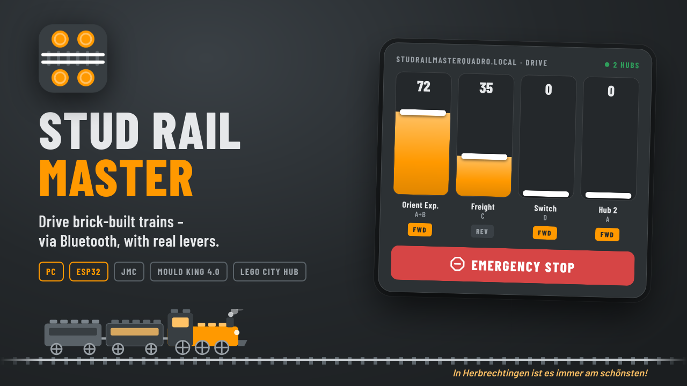
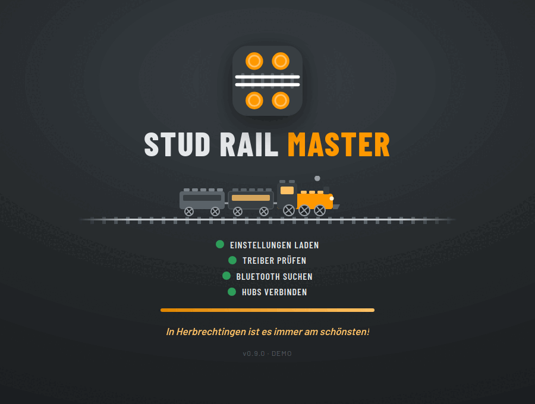
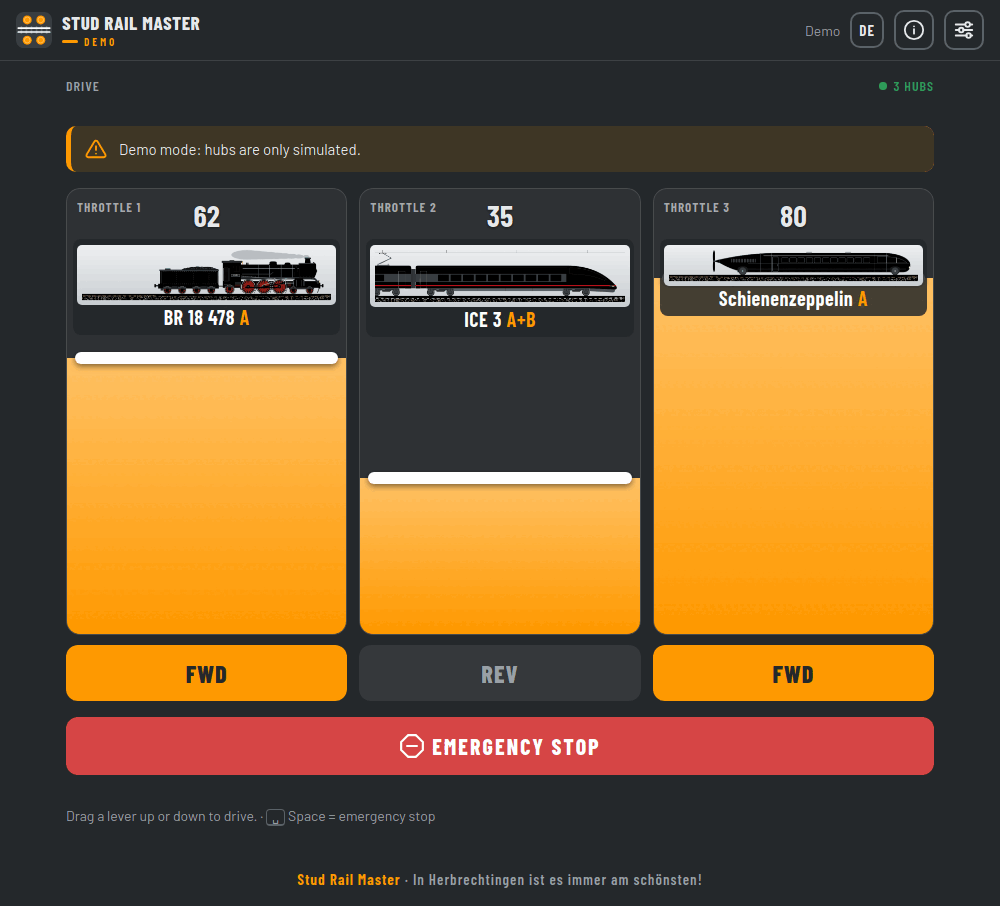

<b>Drive your brick-built trains from your computer or a home-made remote – via Bluetooth, without internet, without an account.</b>

🇩🇪 <a href="README.de.md">Deutsche Fassung</a> · <a href="docs/en/install.md">Installation</a> · <a href="docs/en/user-guide.md">User guide</a> · <a href="docs/en/esp-sync.md">Remote</a>

---

## Why?

The layout runs trains with motor hubs from three makers: a cheap JMC hub, a Mould King 4.0 from the Orient Express and a LEGO City Hub from the freight train 60337. Every hub wants its own phone app. Every app has different sliders, and driving two trains at once means two phones.

I wanted **one control desk for all trains** – ideally with **real levers** you push with your thumb, and a **big red button** that really stops everything. No account, no ads, no cloud. That turned into two things:

| | |
|---|---|
| **Stud Rail Master** – the PC program | for Windows, macOS and Linux. Find hubs, add photos of your trains, assign levers, drive. Needs no extra hardware. |
| **Stud Rail Master Quadro** – the remote | an ESP32 with four slide pots, direction switches and an emergency stop. Drives up to four hubs on its own, no PC needed; set up through a web page in your phone's browser. |

Both share the same drivers and take turns: when the PC starts it takes over the radio, when it quits the remote drives again.

## What it looks like

- **One lever per throttle** – drag up to go faster, one tap to change direction, a big red emergency stop (also on the space bar).
- **Your trains, your pictures** – put a photo on every hub so you always know which lever moves which train.
- **Many trains at once** – up to 16 throttles; one throttle can drive several locomotives, even from different makers.
- **Gentle direction changes** – the train slows down and starts off the other way, instead of jerking.
- **Stays at home** – no internet, no account, no advertising, no data collection.
- **Help built in** – the same guide as here, offline in the program (the **?** button).

## Which hubs?

| Hub | Windows | macOS | Linux | Remote |
|---|:-:|:-:|:-:|:-:|
| **JMC hub** (shows up as “JG_JMC-…”, ports A–D) | ✔ | ✔ | ✔ | ✔ |
| **Mould King 4.0** (ports A–D, up to 3 hubs) | ⚠ not yet tested | ✘ → Linux or ESP32 with web page | ✔ one-time unlock | ✔ |
| **LEGO Powered Up City Hub** (88009, e.g. set 60337, ports A/B) | ✔ | ✔ | ✔ | ✔ |

Planned: LEGO Technic Hub, Mould King 6.0.

## Get started

1. Download the program for your system from the **releases** page and unpack it.
2. Start it, switch your hub on, find it under *Settings → Find hubs*, assign a throttle – and off you go.

Step by step: **[Installation](docs/en/install.md)** · **[User guide](docs/en/user-guide.md)** · **[Together with the remote](docs/en/esp-sync.md)**

Want to try it without a hub first? **Demo mode** simulates three trains (see the user guide).

<b>Or run it from source</b>

With Python 3.10 or newer: download or clone this repository, then start `app/start.sh` (Linux), `app/start.command` (macOS) or `app/start.bat` (Windows). The first start sets everything up and downloads the required Python packages once; after that it starts right away.

## Safety

Some hubs simply keep running their last command when they hear nothing more. So everywhere:

- **Emergency stop** halts every train immediately – even in the middle of a direction change.
- **Nothing moves until every lever has been at 0** – after switching on and after every emergency stop.
- **On quit, on a lost connection and before every restart** a stop is sent actively.
- When you drive through the remote's web page, it triggers an emergency stop as soon as the page has been silent for 2 seconds.

## The long road

No maker has published its protocol (except LEGO). What now fits into a few lines of driver cost quite a few evenings:

<b>JMC: the hub that would not listen</b>

The protocol comes from a capture of the original app: 11 bytes, a checksum, done – or so I thought. The hub still ignored every drive command. The reason: a freshly switched-on hub has to receive a **stop** first, before it moves at all. Then came the second surprise: it has **no watchdog**. If the connection drops, the motor just keeps running – more than 20 seconds in the test, until it was switched off. Since then every path out of the program actively sends stop. And because ports A+B share one speed byte, two motors stuttered as soon as you tried to drive them separately.

<b>Mould King 4.0: radio without a connection</b>

This hub never connects. It is controlled through encrypted **Bluetooth advertising packets** that the app sends every 100 ms with a changing address. The encryption could be rebuilt thanks to other people's work (see [THIRD_PARTY.md](THIRD_PARTY.md)) – and still nothing moved. In broadcast mode Linux drops three inconspicuous bytes (the “flags” `02 01 02`), and **without exactly those three bytes the hub ignores everything**. On Linux the commands now go straight to the Bluetooth chip. macOS doesn't allow that at all. By the way: one reference had forward and reverse swapped.

<b>LEGO City Hub: the impatient one</b>

The only hub with open documentation – and still fussy: if nobody connects right away, it **switches itself off after a few seconds**. So the program no longer searches at leisure but grabs it the moment it shows up.

<b>Packaging: 301 MB for one window</b>

The first Linux program accidentally bundled the whole GTK toolkit and weighed **301 MB** – and still didn't run everywhere, because WebKitGTK can't be packed portably. Now it ships Qt WebEngine (171 MB). The built-in Chromium sandbox failed on locked-down namespaces, an AppImage can't be given special privileges, and the Mould King radio needs exactly such a privilege – so there is now a tiny helper you unlock once with your password. And for a while, the browser opened every time along with the program window.

New findings about hubs go into `drivers/*.json` as test vectors – so PC and remote check on every build that they still send exactly the same bytes.

## The remote

An ESP32 DevKit, four 75 mm slide pots, four toggle switches with an LED for the direction, an emergency-stop button and 4× AA batteries in a printed case. The firmware also works on its own without any of that – then the levers are sliders on the web page `StudRailMasterQuadro.local`.

Schematic, parts list and the printable case will follow once they are finished.

## For developers

The project consists of the PC program (`app/`, Python) and the firmware of the ESP32 remote (`src/`, `lib/`, PlatformIO). Both share the same hub drivers (`drivers/`).

- [Drivers: shared between ESP32 and PC](docs/en/dev/drivers.md)
- [Building, testing, internals](docs/en/dev/building.md)

## License

Free software and open hardware – if you change it and pass it on, you must share it under the same terms:

| Part | License |
|---|---|
| Software (`app/`, `src/`, `lib/`, `test/`, `tools/`, `drivers/`) | [GPL-3.0-or-later](LICENSE) |
| Hardware (`hardware/`: schematic, PCB, enclosure) | [CERN-OHL-S-2.0](LICENSES/CERN-OHL-S-2.0.txt) |
| Docs, images, logo (`docs/`, `README*`) | [CC BY-SA 4.0](LICENSES/CC-BY-SA-4.0.txt) |

Third-party parts (Barlow fonts, prior work on Mould King) and their licenses: [THIRD_PARTY.md](THIRD_PARTY.md).

LEGO® is a trademark of the LEGO Group, Mould King a trademark of its manufacturer. This project is not sponsored or endorsed by either; the names only describe which hubs it works with.

---

<i>In Herbrechtingen ist es immer am schönsten!</i>

